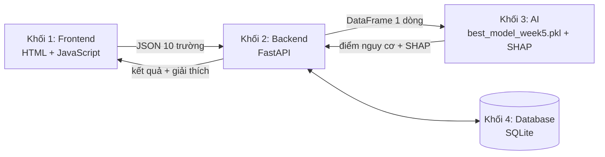

## Phiên bản demo hoàn chỉnh ngày 30/10/2026

Giữ nguyên FastAPI, SQLAlchemy/SQLite, JWT/bcrypt, HTML/CSS/JavaScript, Pandas, scikit-learn, imbalanced-learn, XGBoost, LightGBM, SHAP và matplotlib; không thêm framework hoặc dịch vụ ngoài.

### Khởi chạy và demo

1. Dừng phiên chạy cũ bằng Ctrl+C, rồi chạy `python run.py` (hoặc `run.bat`). Nếu trình duyệt giữ giao diện cũ, dùng Ctrl+F5.
2. Trang đăng nhập có nút Người dùng / Bác sĩ / Admin trong phần **Trải nghiệm nhanh**. Không cần tạo admin thủ công để demo. Đây là tài khoản mẫu dùng chung, dữ liệu sức khỏe ban đầu là giả lập có ghi thời gian khác nhau để trình diễn lịch sử.
3. Form Tạo tài khoản có vai trò Người dùng hoặc Bác sĩ khi chế độ demo được bật.
4. Ngoài giao diện cổng 5500, có thể mở `http://127.0.0.1:8000/web/` trực tiếp trên Backend. Cách này không cần máy chủ frontend riêng.
5. Chế độ local mặc định là demo. Đặt `DEMO_MODE=0` trước khi chạy để tắt đăng nhập demo và tự đăng ký bác sĩ; admin thật cấp quyền bác sĩ từ giao diện. Không công khai bản demo dùng chung.

### Chức năng

- Người dùng: 10 chỉ số có validation, kết quả màu xanh/vàng/đỏ, điểm mô hình, SHAP tăng/giảm, lời nhắc tham khảo, lịch sử và biểu đồ offline.
- Bác sĩ: tìm bệnh nhân theo tên/email, tạo hồ sơ không cần mật khẩu, dự đoán cho hồ sơ cụ thể, chọn ngưỡng riêng từng lần đo, nhập CSV UTF-8/XLSX (tối đa 100 dòng, 2 MB), báo lỗi theo dòng, lọc ca vượt ngưỡng và xuất Excel/PDF. Có CSV mẫu tải từ giao diện. Cột patient_id là tùy chọn để nhập vào hồ sơ cũ; nếu không có, mỗi dòng hợp lệ tạo hồ sơ mới.
- Admin: quản lý vai trò/khóa/xóa tài khoản, bảo vệ chính admin đang đăng nhập, xem toàn bộ lịch sử, thống kê ca vượt ngưỡng theo tuổi/khu vực, xem chỉ số mô hình, reload model và xóa bản ghi lịch sử.
- Tên người dùng, khu vực và nội dung sức khỏe trong lịch sử được mã hóa Fernet bằng cryptography đã có trong dự án. Khi khởi động, dữ liệu plaintext cũ được mã hóa trong transaction. Email đăng nhập vẫn lưu dưới dạng chỉ mục có thể tra cứu, chưa mã hóa toàn bộ file SQLite.

### Mô hình chính

File sử dụng: `outputs/models/model_pipeline.pkl` (alias tương thích: `best_model_week5.pkl`). Backend tự nạp file chính. Bản cũ được giữ ở `outputs/models/legacy_before_final.pkl`.

XGBoost được chọn trong nhóm mô hình cây bằng precision trên dự đoán OOF train, ràng buộc Recall train >=97,5%; tìm tham số bằng RandomizedSearchCV 5-fold ROC-AUC. Đã so sánh Logistic Regression, Random Forest, XGBoost và LightGBM; so sánh SMOTE trong fold với điều chỉnh trọng số. Cấu hình thắng dùng trọng số lớp và không dùng SMOTE. Pipeline chứa cả tiền xử lý, classifier và ngưỡng 0,16404158.

Trên tập kiểm tra phát triển 1.022 mẫu / 50 ca dương tính: Recall 90% (45/50), Precision 8,82%, ROC-AUC 0,8504, PR-AUC 0,2748; TN=507, FP=465, FN=5, TP=45. Nhiều cảnh báo giả là đánh đổi của chế độ nhạy cao. Tập này đã được xem qua nhiều vòng phát triển và điều chỉnh chính sách ngưỡng, không được trình bày như kiểm định độc lập chưa từng sử dụng hoặc kết quả lâm sàng. Xem `MODEL_CARD.md` và `outputs/final/validation_metrics.json`.

Huấn luyện lại: `python run.py --retrain`. Tập dữ liệu raw có thể chứa BMI thiếu; imputer/scaler/encoder chỉ fit trong fold train. Không đưa id, tên hoặc email vào mô hình. Bản huấn luyện cuối giữ fit trên 80% train để kết quả holdout có thể đối chiếu; không fit lại toàn bộ dữ liệu sau đánh giá.

### Kiểm thử và dữ liệu

`venv\Scripts\python.exe -m unittest discover -s tests -v`

Bộ kiểm thử dùng database tạm riêng, gồm auth/phân quyền, ngưỡng bác sĩ, hồ sơ, mã hóa vật lý, import CSV/XLSX, export PDF/XLSX, admin và SHAP. `node --check frontend/app.js` kiểm tra cú pháp giao diện.

Giữ và sao lưu `backend/.data_key` cùng database, `backend/.jwt_secret` cho JWT. Không xóa khóa dữ liệu nếu muốn đọc lại dữ liệu đã mã hóa. Có thể cấp khóa qua `DATA_ENCRYPTION_KEY` / `JWT_SECRET_KEY`. TLS/HTTPS thuộc cấu hình triển khai, local hiện sử dụng HTTP; chưa tuyên bố đạt HIPAA. File PDF backend dùng chữ không dấu với font chuẩn; nút In / Lưu PDF trên trình duyệt giữ tiếng Việt.

---

Các ghi chú dưới đây là lịch sử của lần rà soát trước; ưu tiên hướng dẫn phiên bản demo ở trên.

## Cập nhật sau đối chiếu báo cáo final 30/10/2026

Xem `AUDIT_NOTES.md` để biết các lỗi đã sửa và những tuyên bố trong báo cáo chưa được xác minh.

- Chạy ứng dụng: `python run.py` hoặc `run.bat`.
- Tạo tài khoản quản trị đầu tiên: `venv\Scripts\python.exe backend\create_admin.py` (nhập email và mật khẩu trong terminal). Đăng ký công khai luôn tạo vai trò user. Admin cấp vai trò doctor từ trang quản lý.
- Bác sĩ và admin được đưa đến `QUAN_LY.HTML` sau đăng nhập. Admin có thể đổi vai trò, khóa/mở khóa, xóa tài khoản, xem cấu hình, nạp lại mô hình, xóa một lịch sử theo mã. Bác sĩ tìm bệnh nhân, xem lịch sử/biểu đồ và xuất Excel hoặc PDF qua backend (PDF không dấu); nút In / Lưu PDF sử dụng trình duyệt để giữ tiếng Việt.
- Kiểm thử: `venv\Scripts\python.exe -m unittest discover -s tests -v`. Bài kiểm thử tạo database riêng và không sửa tài khoản thật.
- Huấn luyện mới: `python run.py --retrain`. Kiểm tra chéo 5 fold, tiền xử lý và SMOTE nằm trong mỗi fold; chọn ngưỡng từ dự đoán ngoài fold trên train. Kết quả thực tế lưu ở `outputs/models/validation_metrics.json`, không cam kết tái lập số liệu cũ.
- Chạy thử huấn luyện mà không thay mô hình phục vụ: `venv\Scripts\python.exe src/train_validated.py --output-dir outputs/validated`.
- Cấu hình tùy chọn: `DATABASE_URL`, `JWT_SECRET_KEY`. Mặc định sử dụng `backend/app.db`; khóa JWT local sinh ngẫu nhiên lưu ở `backend/.jwt_secret`, cần giữ ổn định và không đưa lên Git.
- API bổ sung: `/auth/me`, `/health`, `/doctor/export`, `/admin/system`, `/admin/model/reload`, `/admin/history/{id}` cùng các API trong phụ lục báo cáo.

Các phần hướng dẫn cũ bên dưới mang tính lịch sử; khi có khác biệt, ưu tiên hướng dẫn cập nhật này.

<div align="center">

# 🧠 Stroke Risk Screening System

**Hệ thống hỗ trợ sàng lọc sớm nguy cơ đột quỵ dựa trên dữ liệu y tế bằng Machine Learning**


</div>

> ⚠️ **Tuyên bố miễn trừ trách nhiệm (Medical Disclaimer)**
> Hệ thống chỉ mang tính chất tham khảo và hỗ trợ sàng lọc, không thay thế hoàn toàn chỉ định chẩn đoán chính thức từ Bác sĩ chuyên khoa.
> Dự án phục vụ mục đích học tập (đồ án Thực tập cơ sở ngành), **chưa được kiểm chứng lâm sàng** và không dùng để ra quyết định điều trị.

**Mục lục:** [Chạy nhanh](#chạy-nhanh-1-lệnh) · [Bài toán](#1-bài-toán) · [Kiến trúc](#2-kiến-trúc-hệ-thống-4-khối) · [Cấu trúc thư mục](#3-cấu-trúc-thư-mục) · [Giao diện](#4-giao-diện-và-tính-năng) · [Chạy thủ công](#5-cài-đặt-và-chạy-thủ-công) · [Xử lý sự cố](#6-xử-lý-sự-cố) · [Quy trình làm việc](#7-quy-trình-làm-việc) · [Nhóm](#8-nhóm-thực-hiện)

---

## Chạy nhanh (1 lệnh)

**Yêu cầu:** [Git](https://git-scm.com/), [Python](https://www.python.org/downloads/) 3.13 (tối thiểu 3.10; khi cài trên Windows nhớ tick **Add Python to PATH**) và kết nối Internet ở lần chạy đầu.

```bash
git clone <repo-url>
cd DuDoanDotQuy
python run.py
```

- **Windows:** có thể bấm đúp vào file `run.bat` thay cho lệnh `python run.py` (nếu máy không nhận `python`, thử `py run.py`).
- **macOS / Linux:** dùng `python3 run.py`.

Sau khi chạy xong, trình duyệt tự mở trang đăng nhập. Nhấn `Ctrl + C` trong terminal để tắt dự án.

**`run.py` tự làm lần lượt các bước sau** (bước nào đã xong ở lần trước sẽ được bỏ qua nên các lần chạy sau rất nhanh):

| Bước | Việc làm | Bỏ qua khi |
|---|---|---|
| 1 | Tạo môi trường ảo `venv/` | Đã có `venv/` |
| 2 | Cài thư viện từ `requirements.txt` | `requirements.txt` không đổi từ lần cài trước |
| 3 | Tải dữ liệu gốc (`notebooks/01_eda.py`) rồi làm sạch (`notebooks/03_eda.py`) | Đã có `data/raw/...csv` và `data/processed/stroke_clean.csv` |
| 4 | Chia train/test + SMOTE (`src/week3.py`), huấn luyện và so sánh mô hình, lưu `outputs/models/best_model_week5.pkl` (`src/week5.py`) | Đã có `outputs/models/best_model_week5.pkl` |
| 5 | Bật Backend (cổng `8000`) và Frontend (cổng `5500`), mở trình duyệt | Không bao giờ bỏ qua (trừ khi dùng `--setup-only`) |

> Lần chạy đầu tiên mất vài phút (cài thư viện, tải dữ liệu, huấn luyện mô hình).
> `02_eda.py` chỉ vẽ biểu đồ khám phá và mở cửa sổ biểu đồ nên **không** chạy tự động, dùng `--eda` nếu muốn xem.

**Các tùy chọn thêm:**

| Lệnh | Tác dụng |
|---|---|
| `python run.py --dry-run` | Chỉ in ra kế hoạch sẽ làm gì, chưa làm gì cả |
| `python run.py --retrain` | Huấn luyện lại mô hình (chạy lại `week3.py` và `week5.py`) |
| `python run.py --refresh-data` | Tải lại dữ liệu gốc, làm sạch lại và huấn luyện lại |
| `python run.py --eda` | Chạy thêm `02_eda.py` để xem biểu đồ khám phá dữ liệu |
| `python run.py --setup-only` | Chỉ chuẩn bị (cài đặt, dữ liệu, huấn luyện), không bật máy chủ |
| `python run.py --no-browser` | Không tự mở trình duyệt |
| `python run.py --reload` | Backend tự khởi động lại khi sửa code (dùng khi phát triển) |

**Sau khi chạy, truy cập:**

| Thành phần | Địa chỉ |
|---|---|
| Ứng dụng web | http://localhost:5500 (`run.py` tự mở đúng trang đăng nhập) |
| Tài liệu API (Swagger) | http://127.0.0.1:8000/docs |

---

## 1. Bài toán

Từ **10 chỉ số** người dùng nhập, hệ thống ước lượng **điểm nguy cơ đột quỵ**, gán nhãn nguy cơ cao/thấp và **giải thích lý do bằng SHAP**.

| | Mô tả |
|---|---|
| **Đầu vào** | `age`, `gender`, `hypertension`, `heart_disease`, `ever_married`, `work_type`, `Residence_type`, `avg_glucose_level`, `bmi`, `smoking_status` |
| **Đầu ra** | Điểm nguy cơ + nhãn nguy cơ + đóng góp của từng yếu tố (SHAP) |
| **Dữ liệu** | [Stroke Prediction Dataset](https://www.kaggle.com/datasets/fedesoriano/stroke-prediction-dataset) (Kaggle) |
| **Thách thức chính** | Mất cân bằng lớp nghiêm trọng (~5% ca đột quỵ) → đánh giá bằng Precision / Recall / F1, **không dùng riêng Accuracy** |

**Mục tiêu kỹ thuật bắt buộc**

| Yêu cầu | Chỉ tiêu |
|---|---|
| Độ nhạy y tế | Recall ≥ 85–90% trên lớp nguy cơ đột quỵ |
| Thời gian phản hồi | ≤ 2 giây (bao gồm biểu đồ SHAP) |
| Bảo mật | HTTPS/TLS, mã hóa dữ liệu ở tầng CSDL, ẩn danh hóa dữ liệu dùng để huấn luyện lại |
| Phân quyền | 3 vai trò: Người dùng, Bác sĩ (chỉ xem thống kê/lịch sử), Admin (quản lý tài khoản) |
| Theo dõi | Lưu lịch sử và vẽ biểu đồ biến thiên nguy cơ qua các lần nhập liệu |

---

## 2. Kiến trúc hệ thống 4 khối



| Khối | Công nghệ | Trách nhiệm |
|---|---|---|
| **Frontend** | HTML, CSS, JavaScript thuần, Chart.js | Form nhập liệu có validation và chú thích đơn vị, hiển thị kết quả + biểu đồ SHAP, lịch sử/biểu đồ xu hướng, disclaimer |
| **Backend** | FastAPI, SQLAlchemy | Nhận JSON, xác thực & phân quyền (JWT), gọi khối AI, lưu/đọc CSDL |
| **AI** | scikit-learn Pipeline, SHAP | Tiền xử lý + mô hình đóng gói trong **một** file `.pkl`; cung cấp hàm dự đoán kèm giải thích |
| **Database** | SQLite (qua SQLAlchemy) | Tài khoản, kết quả dự đoán, lịch sử. Dự kiến nâng cấp lên PostgreSQL/MySQL khi triển khai thật |

**Nguyên tắc tích hợp (quan trọng)**

- Backend chỉ chuyển JSON thành **DataFrame 1 dòng, đúng 10 cột thô** (đúng tên, đúng kiểu) rồi đưa cho khối AI.
- Backend **không** encode/scale/impute và **không** dùng `pd.get_dummies`; mọi biến đổi nằm trong Pipeline (fit một lần lúc huấn luyện).
- Backend **không** gọi `predict()` trực tiếp mà gọi hàm `predict_with_explanation()` do khối AI cung cấp (trả điểm nguy cơ, nhãn, SHAP; ngưỡng phân loại lưu cùng mô hình).
- Mã hóa bảo mật (*encryption*) xử lý ở tầng CSDL và HTTPS; biến đổi đặc trưng (*encoding*) là việc nội bộ của Pipeline.

> Đặc tả đầy đủ: [`info/DataSpecV3.docx`](info/DataSpecV3.docx)

---

## 3. Cấu trúc thư mục

```text
.
├── run.py                   # ⭐ Chạy cả dự án bằng 1 lệnh (cài đặt → dữ liệu → huấn luyện → máy chủ)
├── run.bat                  # Bấm đúp để chạy trên Windows (gọi run.py)
├── requirements.txt         # Danh sách thư viện Python
├── backend/                 # Mã nguồn phía máy chủ FastAPI
│   └── app/
│       ├── database.py      # Cấu hình SQLite / SQLAlchemy
│       ├── main.py          # Các API Endpoint (Auth, Predict, History)
│       ├── models.py        # Định nghĩa các bảng Database (User, History)
│       ├── schemas.py       # Pydantic validation cho request/response
│       └── security.py      # Mã hóa mật khẩu & tạo JWT Token
├── frontend/                # Giao diện người dùng (Vanilla HTML & JS)
│   ├── DANGKY DANGNHAP.HTML # Giao diện Đăng nhập / Đăng ký
│   ├── TRANG KTRA.HTML      # Giao diện Nhập liệu & Dự đoán AI
│   └── LICH_SU.HTML         # Giao diện Lịch sử & Biểu đồ Chart.js
├── src/
│   ├── preprocessing.py     # build_preprocessor(): ColumnTransformer dùng chung
│   ├── week3.py             # Chia train/test + cân bằng lớp SMOTE
│   └── week5.py             # Huấn luyện + so sánh mô hình, lưu outputs/models/best_model_week5.pkl
├── notebooks/               # Khám phá và xử lý dữ liệu (01_eda, 02_eda, 03_eda)
├── data/                    # (tự tạo khi chạy) raw/ và processed/
├── outputs/
│   └── models/              # best_model_week5.pkl (mô hình AI đóng gói sẵn) + biểu đồ so sánh mô hình
├── info/                    # Tài liệu: Data Spec, đề tài, kế hoạch 10 tuần
└── README.md
```

| Thư mục | Vai trò | Quy ước |
|---|---|---|
| `data/raw` | Bản gốc của dataset (`healthcare-dataset-stroke-data.csv`), tải bằng `01_eda.py` | **Không sửa tay.** Mọi thay đổi phải qua script để tái lập được |
| `data/processed` | `stroke_clean.csv`: dữ liệu đã bỏ cột `id`, giữ 10 cột đặc trưng + nhãn `stroke` | **Chưa** encode/scale/impute (`bmi` vẫn còn giá trị thiếu). Việc này thuộc Pipeline để chỉ fit trên tập train, tránh rò rỉ dữ liệu (*data leakage*) |
| `src` | Mã nguồn tái sử dụng. `preprocessing.py` định nghĩa `build_preprocessor()`: số (`age`, `avg_glucose_level`, `bmi`) → impute median + `StandardScaler`; phân loại (5 cột) → impute + `OneHotEncoder(handle_unknown="ignore")`; `hypertension`, `heart_disease` → giữ nguyên | Huấn luyện và Backend dùng **cùng một** định nghĩa tiền xử lý |
| `outputs/models` | Artifact mô hình mà ứng dụng nạp lúc chạy (`best_model_week5.pkl`) cùng các biểu đồ so sánh mô hình (`.png`). Backend chỉ nạp file mô hình này | `.pkl` phụ thuộc phiên bản scikit-learn → cài đúng phiên bản trong `requirements.txt`. Nếu `.pkl` không được commit lên Git, lần chạy đầu `run.py` sẽ tự huấn luyện ra |

> Các thư mục/tệp sinh ra khi chạy (`venv/`, `data/`, `__pycache__/`, file CSDL `*.db`) không nên commit lên Git, hãy khai báo trong `.gitignore`.

---

## 4. Giao diện và tính năng

Hệ thống cung cấp giao diện Web bằng HTML/JS thuần giúp người dùng thao tác dễ dàng:

- **Đăng ký / Đăng nhập:** xác thực người dùng bằng JSON Web Token (JWT).
- **Trang Sàng lọc (`TRANG KTRA.HTML`):** nhập 10 thông số sức khỏe, gửi yêu cầu qua API FastAPI để nhận **điểm nguy cơ** và biểu đồ giải thích các yếu tố SHAP.
- **Trang Lịch sử (`LICH_SU.HTML`):** truy vấn cơ sở dữ liệu để vẽ biểu đồ biến thiên nguy cơ qua các lần kiểm tra bằng Chart.js.

---

## 5. Cài đặt và chạy thủ công

Chỉ cần khi bạn muốn tự chạy từng bước thay vì dùng `python run.py`.

<details>
<summary><b>Bấm để xem các bước thủ công</b></summary>

### Bước 1: Tạo môi trường ảo và cài thư viện

```bash
git clone <repo-url>
cd DuDoanDotQuy

python -m venv venv
venv\Scripts\activate          # Windows (CMD / PowerShell)
# source venv/bin/activate     # macOS / Linux

python -m pip install --upgrade pip
pip install -r requirements.txt
```

*(Tùy chọn)* Chọn interpreter trong VS Code: `Ctrl + Shift + P` → **Python: Select Interpreter** → chọn `./venv/Scripts/python.exe`.

### Bước 2: Tạo `data/raw` và `data/processed`

Chạy từ **thư mục gốc** của dự án (script dùng đường dẫn tương đối):

```bash
python notebooks/01_eda.py   # Tải dataset gốc vào data/raw/
python notebooks/02_eda.py   # (Tùy chọn) Khám phá, vẽ biểu đồ
python notebooks/03_eda.py   # Làm sạch, xuất ra data/processed/
```

### Bước 3: Chia tập dữ liệu và cân bằng lớp (SMOTE)

```bash
python src/week3.py
```

### Bước 4: Huấn luyện và so sánh mô hình

```bash
python src/week5.py          # Lưu mô hình vào outputs/models/best_model_week5.pkl
```

### Bước 5: Khởi động Backend (FastAPI)

```bash
cd backend
uvicorn app.main:app --reload
```

Backend chạy tại `http://127.0.0.1:8000` (tài liệu API: `/docs`).

### Bước 6: Mở Frontend

Mở một terminal khác (đã kích hoạt venv):

```bash
cd frontend
python -m http.server 5500
```

Truy cập `http://localhost:5500` rồi chọn trang đăng nhập (`DANGKY_DANGNHAP.HTML`).

Cách khác: dùng tiện ích **Live Server** của VS Code, chuột phải vào `DANGKY DANGNHAP.HTML` → *Open with Live Server*.

> Không nên mở file HTML bằng cách nhấp đúp (địa chỉ `file://`): trình duyệt có thể chặn các lời gọi API tới Backend.

</details>

---

## 6. Xử lý sự cố

| Triệu chứng | Cách xử lý |
|---|---|
| `python` không được nhận diện | Cài Python và tick **Add Python to PATH**, hoặc dùng `py run.py` (Windows) / `python3 run.py` (macOS, Linux) |
| Báo cổng `8000` hoặc `5500` đang bị chiếm | Dự án đang chạy ở terminal khác: tắt bằng `Ctrl + C`. Hoặc tìm tiến trình: `netstat -ano \| findstr :8000` rồi `taskkill /PID <số PID> /F` (Windows) |
| Lỗi tải dữ liệu từ Kaggle | Tải thủ công `healthcare-dataset-stroke-data.csv` từ trang dataset, đặt vào `data/raw/` rồi chạy lại `python run.py` |
| `run.py` báo thiếu thư viện | Thêm thư viện được nêu vào `requirements.txt` (mỗi dòng một thư viện) rồi chạy lại |
| Cảnh báo/lỗi phiên bản scikit-learn khi nạp `best_model_week5.pkl` | Huấn luyện lại bằng đúng thư viện đang cài: `python run.py --retrain` |
| Trang web không gọi được API | Kiểm tra Backend đang chạy ở cổng `8000` và bạn mở web qua `http://localhost:5500/...` (không phải `file://`) |
| Muốn làm lại từ đầu | Xóa `venv/`, `data/`, `outputs/models/best_model_week5.pkl` rồi chạy lại `python run.py` |

---

## 7. Quy trình làm việc

- Nhánh `main` luôn chạy được; mỗi người làm trên nhánh riêng: `feature/eda`, `feature/model`, `feature/backend`, `feature/frontend`.
- Mọi thay đổi vào `main` qua **Pull Request** và có ít nhất 1 người review.
- Không commit dữ liệu nhạy cảm, mật khẩu, khóa mã hóa hay file `.env`.
- `run.py` là điểm vào duy nhất để chạy dự án. Khi thêm bước xử lý mới hoặc đổi tên file/cổng, sửa phần **CẤU HÌNH** ở đầu `run.py`; khi thêm thư viện mới, thêm vào `requirements.txt`.

---

## 8. Nhóm thực hiện

| Thành viên | Vai trò |
|---|---|
| Nguyễn Hoàng Hải | Leader, tích hợp hệ thống |
| Vũ Thị Giang | Data Engineer |
| Hoàng Nhật Giang | ML Engineer |
| Trần Xuân Hai | Backend Developer |
| Nguyễn Văn Hoàng | Frontend Developer |

Kế hoạch chi tiết 10 tuần: [`info/Ke_hoach_10_tuan_Chan_doan_Dot_quy V3.docx`](info/Ke_hoach_10_tuan_Chan_doan_Dot_quy%20V3.docx)
