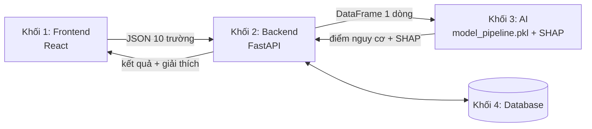

<div align="center">

# 🧠 Stroke Risk Screening System (cách chạy dự án trước tuần 3)

**Hệ thống hỗ trợ sàng lọc sớm nguy cơ đột quỵ dựa trên dữ liệu y tế bằng Machine Learning**


</div>

> ⚠️ **Tuyên bố miễn trừ trách nhiệm (Medical Disclaimer)**
> Hệ thống chỉ mang tính chất tham khảo và hỗ trợ sàng lọc, không thay thế hoàn toàn chỉ định chẩn đoán chính thức từ Bác sĩ chuyên khoa.
> Dự án phục vụ mục đích học tập (đồ án Thực tập cơ sở ngành), **chưa được kiểm chứng lâm sàng** và không dùng để ra quyết định điều trị.

**Mục lục:** [Bài toán](#1-bài-toán) · [Kiến trúc](#2-kiến-trúc-hệ-thống-4-khối) · [Cấu trúc thư mục](#3-cấu-trúc-thư-mục) · [Cài đặt](#4-cài-đặt) · [Quy trình làm việc](#5-quy-trình-làm-việc) · [Nhóm thực hiện](#6-nhóm-thực-hiện)

---

## 1. Bài toán

Từ **10 chỉ số** người dùng nhập, hệ thống ước lượng **điểm nguy cơ đột quỵ**, gán nhãn nguy cơ cao/thấp và **giải thích lý do bằng SHAP**.

| | Mô tả |
|---|---|
| **Đầu vào** | `age`, `gender`, `hypertension`, `heart_disease`, `ever_married`, `work_type`, `Residence_type`, `avg_glucose_level`, `bmi`, `smoking_status` |
| **Đầu ra** | Điểm nguy cơ + nhãn nguy cơ + đóng góp của từng yếu tố (SHAP) |
| **Dữ liệu** | [Stroke Prediction Dataset](https://www.kaggle.com/datasets/fedesoriano/stroke-prediction-dataset) (Kaggle) |
| **Thách thức chính** | Mất cân bằng lớp nghiêm trọng (~5% ca đột quỵ) → đánh giá bằng Precision / Recall / F1, **không dùng riêng Accuracy** |

**Mục tiêu kỹ thuật bắt buộc**

| Yêu cầu | Chỉ tiêu |
|---|---|
| Độ nhạy y tế | Recall ≥ 85–90% trên lớp nguy cơ đột quỵ |
| Thời gian phản hồi | ≤ 2 giây (bao gồm biểu đồ SHAP) |
| Bảo mật | HTTPS/TLS, mã hóa dữ liệu ở tầng CSDL, ẩn danh hóa dữ liệu dùng để huấn luyện lại |
| Phân quyền | 3 vai trò: Người dùng, Bác sĩ (chỉ xem thống kê/lịch sử), Admin (quản lý tài khoản) |
| Theo dõi | Lưu lịch sử và vẽ biểu đồ biến thiên nguy cơ qua các lần nhập liệu |

---

## 2. Kiến trúc hệ thống 4 khối



| Khối | Công nghệ | Trách nhiệm |
|---|---|---|
| **Frontend** | React.js | Form nhập liệu có validation và chú thích đơn vị, hiển thị kết quả + biểu đồ SHAP, lịch sử/biểu đồ xu hướng, Admin Panel, disclaimer |
| **Backend** | FastAPI | Nhận JSON, xác thực & phân quyền (JWT), gọi khối AI, lưu/đọc CSDL, API thống kê |
| **AI** | scikit-learn Pipeline, SHAP | Tiền xử lý + mô hình đóng gói trong **một** file `.pkl`; cung cấp hàm dự đoán kèm giải thích |
| **Database** | PostgreSQL / MySQL | Tài khoản, hồ sơ, kết quả dự đoán, lịch sử |

**Nguyên tắc tích hợp (quan trọng)**

- Backend chỉ chuyển JSON thành **DataFrame 1 dòng, đúng 10 cột thô** (đúng tên, đúng kiểu) rồi đưa cho khối AI.
- Backend **không** encode/scale/impute và **không** dùng `pd.get_dummies`; mọi biến đổi nằm trong Pipeline (fit một lần lúc huấn luyện).
- Backend **không** gọi `predict()` trực tiếp mà gọi hàm `predict_with_explanation()` do khối AI cung cấp (trả điểm nguy cơ, nhãn, SHAP; ngưỡng phân loại lưu cùng mô hình).
- Mã hóa bảo mật (*encryption*) xử lý ở tầng CSDL và HTTPS; biến đổi đặc trưng (*encoding*) là việc nội bộ của Pipeline.

> Đặc tả đầy đủ: [`info/DataSpecV3.docx`](info/DataSpecV3.docx)

---

## 3. Cấu trúc thư mục

```text
.
├── data/
│   ├── raw/                 # Dữ liệu gốc từ Kaggle (chỉ đọc)
│   └── processed/           # Dữ liệu sau làm sạch cơ bản
├── notebooks/               # Khám phá & làm sạch dữ liệu (01_eda, 02_eda, 03_eda)
├── src/
│   └── preprocessing.py     # build_preprocessor(): ColumnTransformer dùng chung
├── models/
│   └── model_pipeline.pkl   # Pipeline đã huấn luyện (tiền xử lý + mô hình)
├── outputs/                 # Biểu đồ, log, kết quả trung gian (figures/, logs/, models/)
├── info/                    # Tài liệu: Data Spec, đề tài, kế hoạch 10 tuần
├── app.py, main.py          # Điểm khởi chạy ứng dụng (đang phát triển)
├── test.py                  # Kiểm thử
├── requirements.txt         # Thư viện Python (ghim phiên bản)
└── README.md
```

| Thư mục | Vai trò | Quy ước |
|---|---|---|
| `data/raw` | Bản gốc của dataset (`healthcare-dataset-stroke-data.csv`), tải bằng `01_eda.py` | **Không sửa tay.** Mọi thay đổi phải qua script để tái lập được |
| `data/processed` | `stroke_clean.csv`: dữ liệu đã bỏ cột `id`, giữ 10 cột đặc trưng + nhãn `stroke` | **Chưa** encode/scale/impute (`bmi` vẫn còn giá trị thiếu). Việc này thuộc Pipeline để chỉ fit trên tập train, tránh rò rỉ dữ liệu (*data leakage*) |
| `src` | Mã nguồn tái sử dụng. `preprocessing.py` định nghĩa `build_preprocessor()`: số (`age`, `avg_glucose_level`, `bmi`) → impute median + `StandardScaler`; phân loại (5 cột) → impute + `OneHotEncoder(handle_unknown="ignore")`; `hypertension`, `heart_disease` → giữ nguyên | Huấn luyện và Backend dùng **cùng một** định nghĩa tiền xử lý |
| `models` | Artifact mô hình mà ứng dụng nạp lúc chạy. Backend chỉ nạp file này | `.pkl` phụ thuộc phiên bản scikit-learn → cài đúng phiên bản trong `requirements.txt` |

---

## 4. Cài đặt

**Yêu cầu:** Git, Python 3.13 (phiên bản nhóm đang dùng, giúp file `.pkl` tương thích), kết nối Internet để tải dataset.

```bash
# 1. Clone repo
git clone <repo-url>
cd <ten-thu-muc-repo>

# 2. Tạo & kích hoạt môi trường ảo
python -m venv venv
venv\Scripts\activate          # Windows (CMD)
# .\venv\Scripts\Activate.ps1  # Windows (PowerShell)
# source venv/bin/activate     # macOS / Linux

# 3. Cài thư viện
python -m pip install --upgrade pip
pip install -r requirements.txt
```

**Chuẩn bị dữ liệu** (chạy từ **thư mục gốc** của repo vì script dùng đường dẫn tương đối):

```bash
python notebooks/01_eda.py   # Tải dataset về data/raw/ và xem tổng quan
python notebooks/03_eda.py   # Xuất data/processed/stroke_clean.csv
# 02_eda.py: vẽ biểu đồ phân bố (mở cửa sổ biểu đồ, nên chạy trong Jupyter/Colab)
```

---

## 5. Quy trình làm việc

- Nhánh `main` luôn chạy được; mỗi người làm trên nhánh riêng: `feature/eda`, `feature/model`, `feature/backend`, `feature/frontend`.
- Mọi thay đổi vào `main` qua **Pull Request** và có ít nhất 1 người review.
- Không commit dữ liệu nhạy cảm, mật khẩu, khóa mã hóa hay file `.env`.

---

## 6. Nhóm thực hiện

| Thành viên | Vai trò |
|---|---|
| Nguyễn Hoàng Hải | Leader, tích hợp hệ thống |
| Vũ Thị Giang | Data Engineer |
| Hoàng Nhật Giang | ML Engineer |
| Trần Xuân Hai | Backend Developer |
| Nguyễn Văn Hoàng | Frontend Developer |

Kế hoạch chi tiết 10 tuần: [`info/Ke_hoach_10_tuan_Chan_doan_Dot_quy V3.docx`](info/Ke_hoach_10_tuan_Chan_doan_Dot_quy%20V3.docx)
